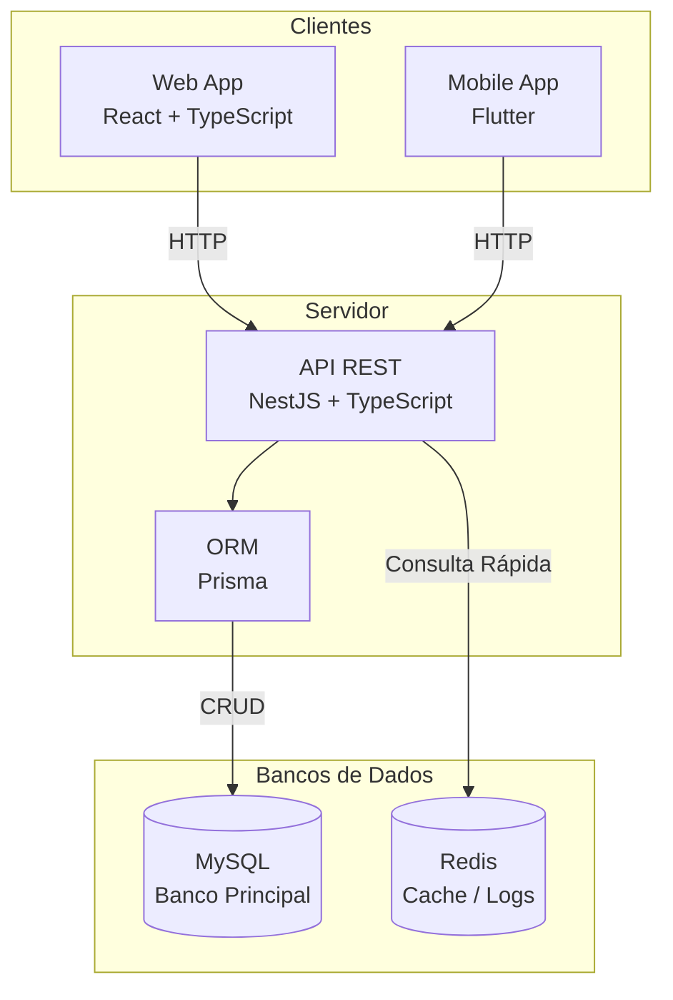

### Sprint 4
> **Pensamento Computacional e Automação com Python**  
> **Soluções em Energias Renováveis e Sustentáveis**

---

### Equipe

Nome Completo | RM | Função | GitHub |
| :--- | :---: | :--- | :---: |
| **Enzo Seiji Delgado Tabuchi** | 573156 | ⚙️ Backend / 🤖 IA | [@enzo-tabuchi-github](https://github.com/enzotabuchii) |
| **Henrique Almeida Lucareli** | 569183 | 📊 Dados / 📱 Mobile | [@henrique-lucareli-github](https://github.com/HenriqueAlmeidaLucareli) |
| **Leonardo Scotti Tobias** | 573305 | 🎨 Frontend | [@leonardo-scotti-github](https://github.com/leonardo-scotti) |
| **Luca Almeida Lucareli** | 569061 | ⚙️ Backend / 📊 Dados | [@luca-lucareli-github](https://github.com/LucaLucareli) |
| **Natan Silva da Costa** | 573100 | 📱 Mobile / 🎨 Frontend | [@natan-costa-github](https://github.com/natan-costa01) |

---

### Esquema de Integração e Arquitetura

O ecossistema do projeto é composto pelas seguintes frentes:
1. **Frontend Web:** React/TS
2. **Mobile:** Flutter
3. **Backend/API:** Nestjs/TS
4. **Banco de Dados:** MySQL & Redis
5. **Protótipo Visual:** Figma

### Diagrama de Arquitetura

---

### Justificativa Técnica das Escolhas

Nossa arquitetura foi desenhada com foco em eficiência, alta escalabilidade e robustez, garantindo que o sistema suporte o crescimento da operação e a integração contínua de novos dispositivos:

* **Backend (Node.js com NestJS):** Escolhido por sua arquitetura estritamente modular e suporte nativo a TypeScript, o NestJS aplica padrões de projeto corporativos (como injeção de dependência e forte tipagem). Essa estrutura garante alta performance no processamento de requisições assíncronas e facilita a criação de APIs RESTful resilientes, requisitos essenciais para suportar a ingestão contínua, escalável e em tempo real dos dados de telemetria enviados pelos sensores de energia.
* **Frontend Web (React) e Mobile (Flutter):** Adotamos uma estratégia de interface orientada a componentes reativos. O React possibilita a construção de painéis administrativos web dinâmicos e de rápida renderização. Para o ecossistema móvel, o Flutter foi selecionado por entregar performance nativa tanto em iOS quanto em Android a partir de uma base de código única. Juntos, eles garantem atualizações de estado em tempo real e proporcionam uma jornada de usuário fluida, intuitiva e sem atritos na gestão, acompanhamento e pagamento das recargas.
* **Persistência de Dados Híbrida (MySQL & Redis):** Utilizamos uma abordagem de banco de dados em duas camadas para otimizar o desempenho sem abrir mão da segurança. O MySQL (banco de dados relacional) garante conformidade ACID, integridade referencial e auditoria para dados críticos e estruturados, como faturamento, cadastro de usuários e histórico consolidado de consumo energético. Complementarmente, o Redis (armazenamento em memória) atua como um motor de altíssimo desempenho para gestão de cache, controle de sessões e armazenamento do estado transitório dos sensores, reduzindo a latência de comunicação a milissegundos.

---

### Resultados e Dados Funcionais

Nesta etapa de prototipagem funcional, alcançamos os seguintes resultados:
* **Integração Back:** Comunicação estabelecida com sucesso. Ao disparar algumas rotas via Postman ou Insomnia, o backend registra ou busca no banco de dados.
* **Jornada Visual (Figma):** O mapeamento completo das telas de monitoramento e automação já está finalizado e validado.
* **Ĩmplementação Front:** Telas no mobile e web estão sendo implementadas para poder serem integradas com o back.

### Os repositórios dos códigos
- front: https://github.com/vencedoresdonext/goodwe-challenge-front
- back: https://github.com/vencedoresdonext/goodwe-challenge-service
- mobile: https://github.com/vencedoresdonext/goodwe-challenge-mobile
